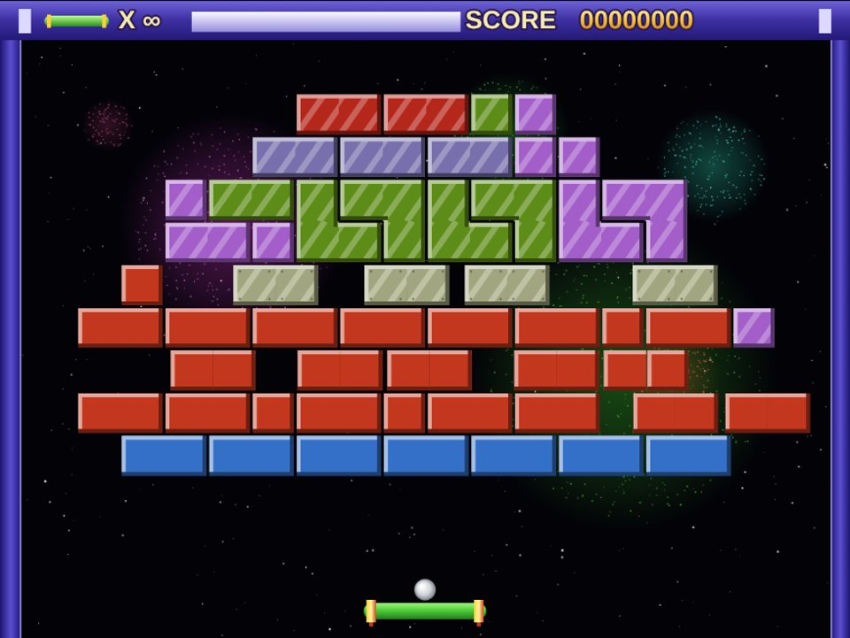

# BlokYıldızı

Tarayıcıda, telefonda ve Android TV'de oynanabilen 74 bölümlük bir tuğla kırma oyunu.

**▶ Oyna:** https://hamikumbasae.github.io/blok-kirma/

## Hayran yapımı — yasal not

BlokYıldızı, eski Topfield uydu alıcılarında bulunan *ExBlock* oyununa duyulan sevgiyle yapılmış, **kâr amacı gütmeyen, bağımsız bir hayran oyunudur**.

- Orijinal oyunun kodu, görselleri, sesleri veya dosyaları **kullanılmamıştır**. Oyun motoru ve tüm çizimler sıfırdan yazılmıştır.
- Bölüm düzenleri, orijinal oyunun oynanış kayıtlarından esinlenerek yeniden oluşturulmuştur.
- Topfield ve ExBlock adları ile ilgili tüm haklar sahiplerine aittir. Bu proje onlarla bağlantılı değildir ve onlar tarafından onaylanmamıştır.
- Oyun ücretsizdir; reklam, satış veya başka bir gelir amacı yoktur.
- Hak sahiplerinden bir talep gelirse ilgili içerik derhal kaldırılır. İletişim için bu depoda bir *issue* açabilirsiniz.

## Nasıl oynanır

| | Klavye | Telefon | TV kumandası |
|---|---|---|---|
| Çubuğu hareket ettir | ← → veya A D | Ekranı sürükle / ◀ ▶ | ◀ ▶ |
| Topu at / seç | Boşluk veya Enter | Seç / Topu at | OK |
| Duraklat | P | Duraklat | ⏯ veya kırmızı |
| Hız (1× – 2.5×) | H | Hız | Sarı veya ⏩ |
| Sonsuz can aç/kapa | L | Can | Yeşil |
| Menü / çıkış | Esc | Menü | ← Geri |

Menüden **New Game**, **Continue** (kaldığın bölümden) veya **Stage Select** (istediğin bölüm) seçilebilir. Sonsuz can varsayılan olarak açıktır.

**Ödül baloncukları:** altın çekirdek = lazer çubuk · üç gümüş top = üçlü top · yeşil çubuk = ekstra can · mavi = yavaşlatma · mor = geniş çubuk · turuncu = hızlandırma. Ara sıra tuğlaları delip geçen ateş topu çıkar; ekranda dolaşan yaratıkları vurmak ek puan verir.

## Android TV'ye kurulum

1. TV'de Google Play'den **Downloader** uygulamasını kur.
2. Ayarlar → Cihaz Tercihleri → Güvenlik ve kısıtlamalar → Bilinmeyen kaynaklar'dan Downloader'a izin ver.
3. Downloader'da şu adresi aç: `hamikumbasae.github.io/blok-kirma/tv.apk`
4. **Yükle** → **Aç**. Oyun uygulamalar arasında *BlokYıldızı* adıyla görünür ve internetsiz çalışır.

Güncellemek için aynı adresten tekrar indirip kurmak yeterlidir; kayıtlar silinmez.

## Geliştirme

- `index.html`, `src/game.js` — oyun motoru (tek sayfa, bağımlılık yok)
- `src/levels.js` — 74 bölümün haritaları
- `tests/levels.test.js` — harita doğrulama: `node tests/levels.test.js`
- `android/` — Android TV kabuğu (WebView); her `main` push'unda GitHub Actions ile derlenir
- Her push'ta site GitHub Pages'e otomatik yayınlanır (`.github/workflows/pages.yml`)

Yerelde denemek için depo kökünde `python3 -m http.server` çalıştırıp `http://localhost:8000` adresini aç. Doğrudan bölüm açmak için adrese `#stage12`, bölüm listesi için `#stages` ekle.

## Lisans

Bu depodaki **kod** MIT lisansıyla sunulmuştur (bkz. [LICENSE](LICENSE)). Bu lisans, yukarıdaki yasal notta belirtilen üçüncü taraf ad ve tasarımları kapsamaz.
